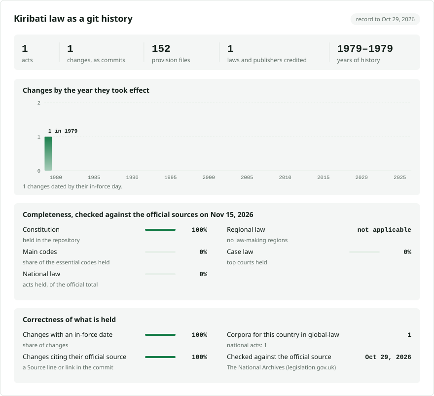

# Kiribati: law history in git

<picture>
<source media="(prefers-color-scheme: dark)" srcset="data/effort-dark.svg">

</picture>

The law of Kiribati as a git history: one file per section, one commit per version on the day it took effect, and the law that made each change as the commit's author. `git blame` names the law behind every line; `git log` lists every change to a section; picking a date gives the text this record holds for that day.

Part of [lexifina/global-law](https://github.com/lexifina/global-law), one git history for every country's law: this is Kiribati's national law, which global-law reads at `kiribati/national/acts/`.

**What is in it now:** one text: the Constitution of Kiribati as made, the Schedule to the Kiribati Independence Order 1979 (SI 1979/719), in its one version, in force from independence on 12 July 1979: the Preamble, 139 sections, the titles of its 10 chapters and Schedule 2. Its later amendments, and every other Kiribati law, are not here yet. [`constitution/README.md`](constitution/README.md) lists every provision; [`data/laws.csv`](data/laws.csv) lists the law behind the version.

Each provision is one file in `constitution/`: `sec-006.md` is section 6, protection from slavery and forced labour; `chapter-02.md` is the title of Chapter 2, `preamble.md` the Preamble and `schedule-2.md` Schedule 2, the territory of Kiribati.

The text is in English, as legislation.gov.uk publishes the Order as made.

## Questions as git commands

| Question | Command |
| --- | --- |
| Every change to section 6 of the Constitution | `git log -p --word-diff -- constitution/sec-006.md` |
| Which law wrote each line of section 6? | `git blame constitution/sec-006.md` |
| Every version of section 6, with the day each took effect | `git log --format="%h %(trailers:key=In-force,valueonly,separator=) %an" -- constitution/sec-006.md` |
| Section 6 on 1 January 1980 | `python tools/on.py 1980-01-01 constitution sec-006` |

**Outside git**, we also host this record publicly, for free:

- **[Ask Claude about Kiribati law](https://global-law.lexifina.com/v1/try_claude?country=kiribati)**: opens Claude with a first question ready.
- **[Ask ChatGPT](https://global-law.lexifina.com/v1/try_chatgpt?country=kiribati)**: the same question in ChatGPT.
- **[Search Kiribati law on our site](https://lexifina.com/law?country=kiribati&q=forced+labour)**: a search for "forced labour", with each provision's text and its versions, no account needed.
- **[Developer REST API](https://global-law.lexifina.com/v1/search_law?query=forced+labour&jurisdiction=kiribati)**: the same search as JSON, with no key. See the [documentation here](https://lexifina.com/api/global-law).

Both assistants read the record through the free Global law connector (MCP, `https://global-law.lexifina.com/mcp`); the first time, the chat gives you the link that adds it. Ask in English.

**Host it yourself easily.** All it takes is git and Python, and the tools run on your machine:

```sh
git clone --depth 1 https://github.com/lexifina/global-law && cd global-law
python3 tools/countries.py add kiribati/national/acts
python3 tools/law.py show 1980-01-01 kiribati/national/acts/constitution/sec-006.md
```

Opened in Claude Code, Cursor, VS Code or Codex, the clone also starts a local MCP server with the same tools ([MCP.md](https://github.com/lexifina/global-law/blob/main/MCP.md)).

## Dates

Each commit is dated at noon, Pacific/Tarawa, on the day the version took effect, and carries it in its `In-force:` trailer:

- the one version, the Constitution as made, is dated 12 July 1979, independence day, when it came into force;
- its `Enacted:` trailer gives the day the Order was made (26 June 1979) and `Published:` 4 July 1979, both from legislation.gov.uk's record of the Order.

The version is credited to the Order that made it (`SI 1979/719`), and tagged `constitution/1979-07-12` and `law/si-1979-719`.

## How it is checked

- `tools/check_repo.py` reads every version back from git on the day it took effect, and on the day before, and compares it, file by file, with the corpus it was built from (its sha256 is in [`data/corpus.sha256`](data/corpus.sha256)); every commit's trailers must parse.
- `tools/build.py` writes the history from that corpus in one pass, and the same corpus always gives the same commit hashes. [`REPRODUCE.md`](REPRODUCE.md) gives the builder's hashes; it does not yet record a check run or a second build.
- History is append-only: no merge commits, no rewriting, no commit dated in the future.
- [vulnerabilities/](vulnerabilities/): possible drafting mistakes in this law, found by global-law's detectors and checked by hand. Not run yet.

## What it does not show

- **Amendments.** The Constitution has been amended since 1979; no amendment is applied, so this is not the text in force today.
- **Any other Kiribati law.** No statute, subsidiary legislation, treaty or court decision is here yet.
- **Schedule 1** (the oaths and affirmations), which the source publishes only as images, and the part headings inside chapters; chapter titles are kept.
- **The Order itself.** Only its Schedule, the Constitution, is here, not the Order's own articles.

## Sources

| Source | Kind | Past versions | Notes |
| --- | --- | --- | --- |
| [legislation.gov.uk](https://www.legislation.gov.uk/uksi/1979/719/made) (The National Archives) | UK statutory instrument, as made: the Kiribati Independence Order 1979 | no, only as made | The Constitution is the Schedule to the Order |

## Licence

See [`LICENSE`](LICENSE). The text is taken from legislation.gov.uk and contains public sector information licensed under the Open Government Licence v3.0; Lexifina's tooling and documentation in this repository are under the MIT licence.

No AI model wrote, translated or corrected legal text; the scripts were written by an AI model (see [`REPRODUCE.md`](REPRODUCE.md)).

## Visualisations

- [visualisations/](visualisations/): charts drawn from this repository. Not drawn yet.

## More

From [lexifina/global-law](https://github.com/lexifina/global-law):

- [FEATURES.md](https://github.com/lexifina/global-law/blob/main/FEATURES.md): every feature, and what every corpus must support (`git blame`, `law.py`, the MCP tools)
- [FAQ.md](https://github.com/lexifina/global-law/blob/main/FAQ.md): questions and answers · [CONTRIBUTING.md](https://github.com/lexifina/global-law/blob/main/CONTRIBUTING.md): proposing changes · [MCP.md](https://github.com/lexifina/global-law/blob/main/MCP.md): the MCP server · [REPRODUCE.md](https://github.com/lexifina/global-law/blob/main/REPRODUCE.md): how it was built · [CHANGELOG.md](https://github.com/lexifina/global-law/blob/main/CHANGELOG.md)
- [FRESHNESS.md](https://github.com/lexifina/global-law/blob/main/FRESHNESS.md): how current each corpus is · [Monitoring](https://github.com/lexifina/global-law/tree/main/monitoring): whether updates are running · [WATCHING.md](https://github.com/lexifina/global-law/blob/main/WATCHING.md): how each official source is watched for changes
- [performance/](https://github.com/lexifina/global-law/tree/main/performance): how fast the tools are, measured
- [visualisations/](https://github.com/lexifina/global-law/tree/main/visualisations): charts and bridges across the world's law
- [Vulnerabilities](https://github.com/lexifina/global-law/tree/main/vulnerabilities): mistakes in legislation as published
